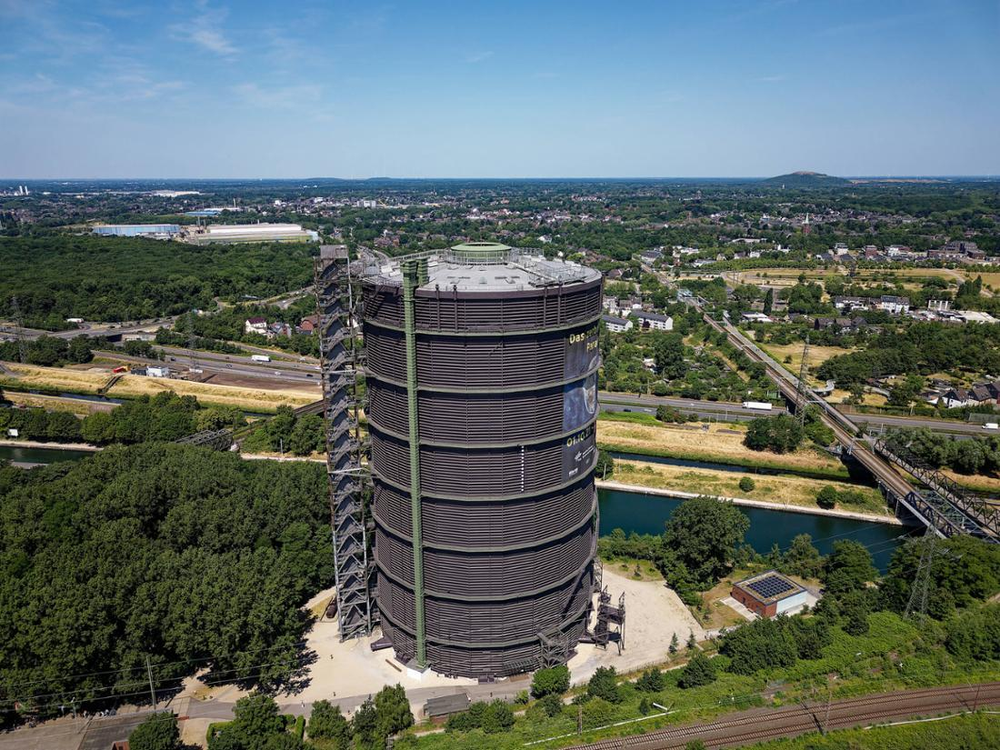
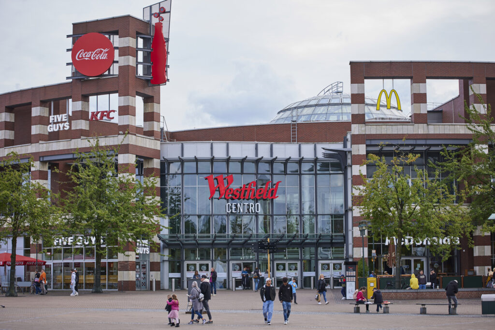

#  Oberhausen – Eine Stadt im Ruhrgebiet

## Über Oberhausen

- Oberhausen ist eine Stadt in Nordrhein-Westfalen, Deutschland.

- Die Stadt liegt im Ruhrgebiet.

- Heute ist die Stadt ein beliebtes Ziel für Touristen.

## Sehenswürdigkeiten

## 1. Gasometer Oberhausen

- Der Gasometer ist das Wahrzeichen von Oberhausen.
- Früher wurde hier Gas gespeichert.
- Heute gibt es interessante Ausstellungen.
- Von oben hat man einen schönen Blick über das Ruhrgebiet.

## 2. Westfield Centro

- Das Westfield Centro ist ein großes Einkaufszentrum.
- Es gibt viele Geschäfte.
- Besucher finden Restaurants und Cafes.

## 3. Kaisergarten

- Der Kaisergarten ist ein schöner Park in Oberhausen.
- Man kann spazieren gehen.
- Es gibt Grünflächen und Spielplätze.
- Familien können Tiere im Tiergehege sehen.
- Der Park liegt in der Nähe von Schloss Oberhausen.

4. SEA LIFE Oberhausen

- SEA LIFE ist ein Aquarium für die ganze Familie.
- Besucher können verschiedene Meerestiere entdecken.
- Es gibt viele Fischarten.
- Kinder können etwas über die Unterwasserwelt lernen.

5. Schloss Oberhausen

- Schloss Oberhausen ist ein historisches Gebäude.
- Hier befindet sich die Ludwiggalerie.
- Es gibt wechselnde Kunstausstellungen.
- Das Schloss liegt am Kaisergarten.

## Natur und Freizeit

- In Oberhausen gibt es viele Möglichkeiten für Freizeitaktivitäten.

1. Fahrrad fahren
2. Spazieren gehen
3. Museen besuchen
4. Einkaufen
5. Restaurants besuchen

## Weitere Informationen

- [Stadt Oberhausen](https://www.oberhausen.de)

- [Oberhausen Tourismus](https://www.oberhausen-tourismus.de)

[Zurück zur Startseite](index.md)